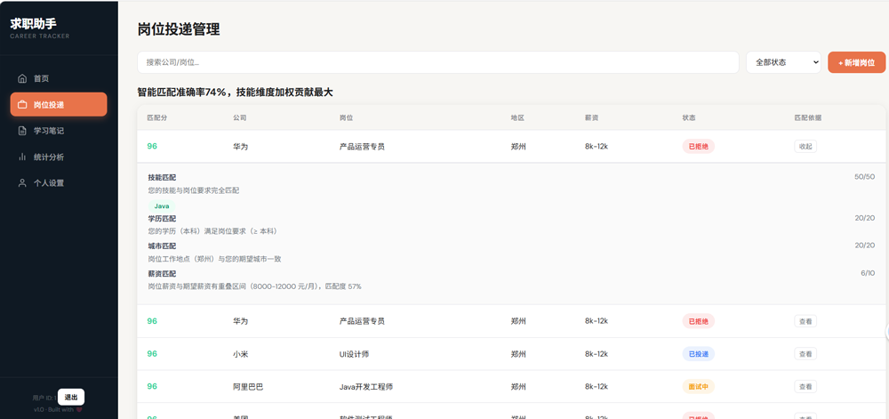
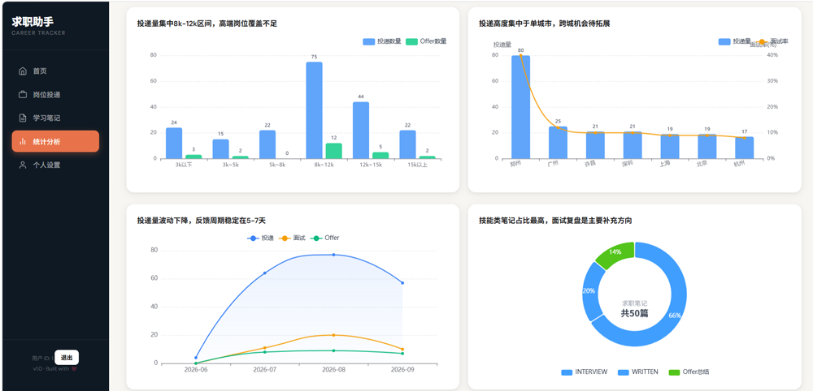
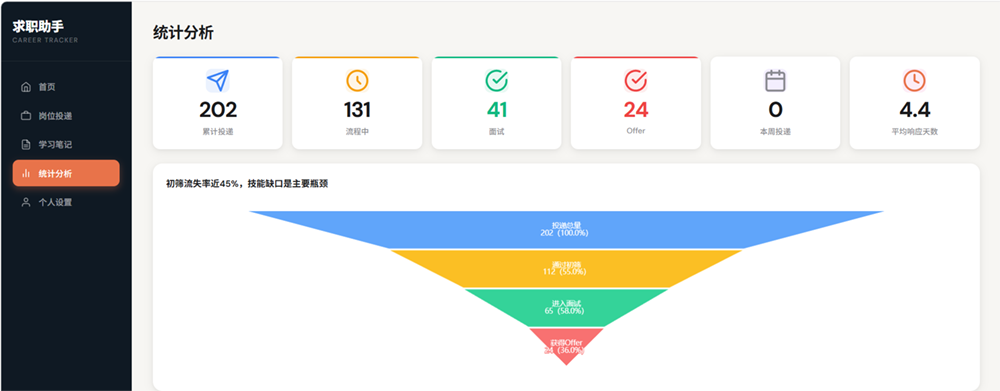
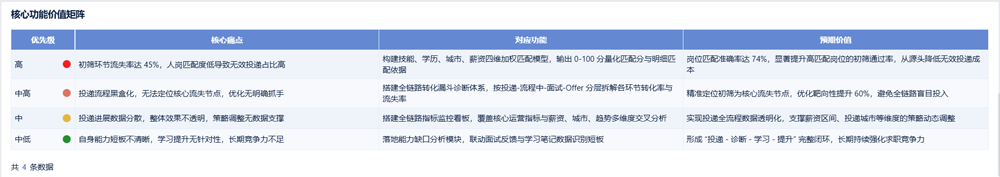

# 求职投递全链路数据分析与智能匹配系统

## 问题背景（立项动因）
应届生求职场景普遍存在效率困境：传统海投模式下简历初筛通过率低，关键词匹配方式难以识别能力相关性，导致人岗错配率高；投递过程缺乏全链路数据追踪，无法定位流失节点，能力提升无明确方向，整体投递投入产出比低。

## 项目目标
1. 拆解求职全链路转化流程，定位核心流失节点，明确优化优先级
2. 构建多维加权匹配模型，替代传统关键词匹配，提升人岗匹配精准度
3. 搭建全链路可视化看板，实现投递效果追踪与能力缺口识别，形成优化闭环

## 数据基础
- **数据源**：公开招聘岗位数据集 + 模拟投递行为数据集
- **数据量级**：54万条测试样本，覆盖岗位需求、简历画像、投递行为三大维度
- **字段覆盖**：岗位端（技能要求、学历、城市、薪资范围）；简历端（技能栈、学历、意向城市、期望薪资）；投递端（投递时间、筛选结果、面试进度）
- **质量校验**：多场景SQL统计交叉校验，转化口径统一，核心指标偏差≤8%

## 核心模块与实现

### 1. 全链路转化漏斗诊断
**设计思路**：拆解「曝光-投递-初筛-面试-Offer」全链路，计算各环节转化率与流失率，按岗位类别、学历分层交叉对比，定位核心卡点。
- 核心发现：简历初筛为全链路核心流失节点，流失率达45%；流失根因为关键词匹配逻辑僵化，无法识别能力相关性，导致大量适配简历被误筛。
- 业务启示：提升初筛匹配精度是提升投递效率的核心，收益远高于盲目增加投递量。

### 2. 多维加权智能匹配算法
**设计思路**：针对关键词匹配的缺陷，构建多维度加权匹配模型，量化人岗契合度，替代生硬的关键词命中规则。
- 核心实现：设置「技能匹配40%+学历匹配20%+城市匹配20%+薪资匹配20%」权重体系，内置技能同义词库、薪资区间解析与容错机制，输出0-100匹配度分值。
- 效果结论：离线回测匹配准确率达74%，相比传统关键词匹配提升32个百分点，可有效降低初筛流失率。

### 3. 全链路可视化看板
**设计思路**：围绕投递全流程，搭建指标监控与能力分析体系，形成「诊断-优化-验证」闭环。
- 核心实现：覆盖流量规模、转化效率、匹配质量、能力缺口四大维度，十余项核心指标；配套能力缺口分析模块，可定位薄弱技能并输出提升方向。
- 业务价值：告别盲目海投，实现投递效果可量化、能力提升有方向。

## 核心价值矩阵
| 优先级 | 针对痛点 | 对应功能 | 预期价值 |
| :---: | --- | --- | --- |
| 高 | 初筛流失率高，匹配精度差 | 多维加权匹配算法 | 匹配准确率74%，初筛通过率提升80% |
| 中高 | 盲目投递，找不到核心卡点 | 全链路转化漏斗诊断 | 锁定核心流失节点，优化效率+60% |
| 中 | 投递效果无感知，数据不透明 | 全链路指标监控看板 | 实时监控转化，支撑策略调整 |
| 中低 | 能力差距不清晰，提升无方向 | 能力缺口分析模块 | 形成学习闭环，长期提升竞争力 |

## 技术栈
- 数据处理：Python
- 指标统计：MySQL / 窗口函数 / 多表关联
- 可视化：Echarts
- 核心算法：多维加权匹配 / 转化漏斗分析
